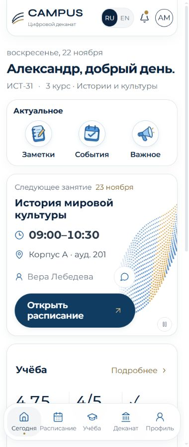

# CAMPUS · Цифровой деканат

Конкурсный прототип. Не является официальным сервисом учебного заведения.

Рабочее пространство студента и преподавателя с расписанием гуманитарных дисциплин, посещаемостью, сессией, оценками по 100-балльной шкале, профилем и документами. В кабинете также доступны заявки, чат, заметки и полноэкранные истории. Данные демонстрационные. Интерфейс поддерживает русский и английский языки, светлую и тёмную темы.

## Запуск готового сайта

Установите Node.js 24 и выполните из корня репозитория:

```sh
node campus/portable/serve.mjs
```

Откройте [страницу входа](http://127.0.0.1:3048/index.html). В Windows можно дважды нажать на `campus/portable/Start.cmd`. Зависимости уже включены в эту сборку. Локальная SQLite-база создаётся при запуске, учебные записи заполняются приложением. Для работы кнопок входа нужен запущенный сервер.

На экране входа выберите студента Александра Миронова или преподавателя Веру Лебедеву. Логины и публичный демонстрационный пароль приведены в [DEMO_CREDENTIALS.md](campus/DEMO_CREDENTIALS.md). Аккаунты общие для посетителей. Используйте вымышленные сведения.

## Где редактировать

| Путь | Назначение |
| --- | --- |
| `campus/src/components`, `campus/src/app/globals.css` | Экраны и стили. Сборка переносит их в версию для хостинга |
| `campus/src/lib` | Типы, расчёты успеваемости и учебные данные |
| `campus-showcase/client`, `campus-showcase/worker` | Точка входа опубликованного интерфейса, маршруты API, авторизация, права доступа и демонаполнение |
| `campus-showcase/drizzle` | SQL-миграции опубликованной версии |
| `campus/portable` | Готовая автономная сборка для локальной демонстрации |
| `timeweb` | Точное содержимое архива развёрнутой версии, включая сервер, Caddy и Docker Compose |
| `campus/src/app`, `campus/src/server` | Вариант на Next.js для разработки |
| `campus/tests`, `campus-showcase/checks` | Проверки учебной логики, API и публичного интерфейса |

## Разработка и сборка

Для разработки Next.js из папки `campus` выполните `npm install` и `npm run dev`. Откройте http://127.0.0.1:3000. Команды `npm run typecheck` и `npm test` проверяют типы и модульные тесты.

Для пересборки версии хостинга из папки `campus-showcase` выполните:

```sh
npm install
npm run build
node export-html.mjs
```

Обновлённые `index.html` и `backend.mjs` появятся в `campus/portable`. Для следующего релиза скопируйте оба файла в `timeweb`. При изменении схемы перенесите новые SQL-миграции из `campus-showcase/drizzle` в обе поставки. Проверки со сменой данных запускайте на отдельной локальной базе.

## Развёртывание с HTTPS

Для запуска готовой сборки нужен сервер с Docker Compose, доменное имя с DNS-записью на сервер и доступные порты 80 и 443. В каталоге `timeweb` скопируйте `.env.example` в `.env`, задайте `CAMPUS_HOST` равным вашему домену без протокола и выполните:

```sh
docker compose up -d
docker compose ps
```

Caddy обслуживает HTTPS. Node.js выполняет серверную логику и работает с SQLite. Именованный том `campus-data` хранит базу между перезапусками. При обновлении сохраняйте каталог развёртывания, имя проекта Compose и том с данными. Команда `docker compose down -v` удаляет тома.

## Данные и публикация

Вход и доступ к персональным записям проверяет сервер. База, активные сессии и рабочие настройки создаются на конкретном сервере. Для реальных студентов потребуются индивидуальные учётные записи и отдельные правила хранения данных. Справки и пропуска в прототипе демонстрационные.

Для GitHub распакуйте архив и загрузите его **содержимое** в корень репозитория, включая скрытые файлы. GitHub хранит исходники. Для работы приложения используйте серверный запуск выше.

## Экраны кабинета



[Расписание](screenshots/campus-schedule.jpg) · [Сессия](screenshots/campus-session.jpg) · [Истории](screenshots/campus-story.jpg)
